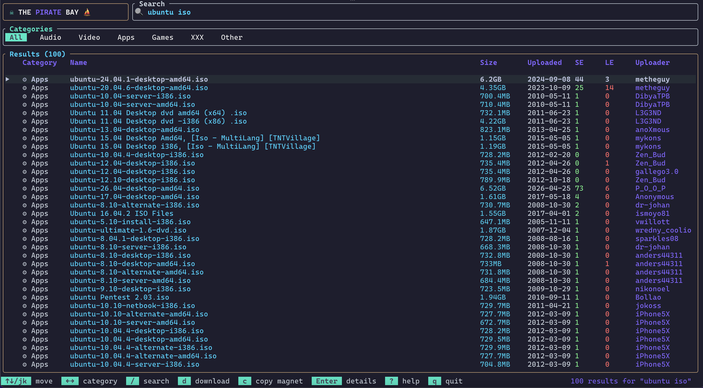

# The Pirate Bay CLI

<p>
  <a href="https://flakehub.com/flake/tsirysndr/piratebay" target="_blank">
    
  </a>
  <a href="https://crates.io/crates/piratebay" target="_blank">
    
  </a>
  <a href="https://crates.io/crates/piratebay" target="_blank">
    
  </a>
  <a href="https://docs.rs/piratebay" target="_blank">
    
  </a>
  <a href="LICENSE" target="_blank">
    
  </a>
  <a href="https://github.com/tsirysndr/piratebay/actions/workflows/release.yml" target="_blank">
    
  </a>
  <a href="https://github.com/tsirysndr/piratebay/actions/workflows/rust-clippy.yml" target="_blank">
    
  </a>
</p>

PirateBay helps you search **and download** torrents right from the terminal — pure Rust, async (tokio), no native C dependencies. It ships as an interactive **TUI**, a scriptable **CLI**, and a reusable **library**.

  

## Table of Contents

- [Features](#features)
- [Installation](#installation)
- [Interactive TUI](#interactive-tui)
  - [Keybindings](#keybindings)
- [CLI Usage](#cli-usage)
  - [Search](#search)
  - [Get torrent info (and magnet link)](#get-torrent-info-and-magnet-link)
  - [Browse a category](#browse-a-category)
  - [Choosing sources](#choosing-sources)
  - [Download](#download)
  - [Streaming to a media player](#streaming-to-a-media-player)
  - [JSON output](#json-output)
- [Categories](#categories)
- [Library](#library)
- [Development](#development)
- [License](#license)

# Features

- **Interactive TUI** (built with [ratatui](https://ratatui.rs)) — search, browse by category, inspect details, download, and copy magnet links without leaving the terminal
- Search The Pirate Bay, [Nyaa](https://nyaa.si), [Bitsearch](https://bitsearch.eu), [LimeTorrents](https://www.limetorrents.fun) and [TorrentDownload](https://www.torrentdownload.info) from the terminal — queried concurrently, merged and de-duplicated by info hash (table or `--json` output)
- Browse by category (audio, video, applications, games, XXX, other)
- Pure-Rust torrent downloader (powered by [`librqbit`](https://crates.io/crates/librqbit), rustls only — **no OpenSSL, no system C libs**)
- Live progress bar with throughput (bytes/sec) and ETA
- `--stream` mode: pipe the largest file to stdout as it downloads — works with mpv, VLC, ffplay
- Copy magnet links straight to the system clipboard (via OSC 52 — works over SSH)
- Usable as an async Rust **library** (`use piratebay::pirateclient::PirateClient`)
- A cohesive color theme shared across the TUI, CLI help, and download progress

# Installation

### Install script (Linux, macOS, *BSD)

Download the latest prebuilt binary with `curl` and `bash`:

```bash
curl -fsSL https://raw.githubusercontent.com/tsirysndr/piratebay/main/install.sh | bash
```

It auto-detects your OS/arch, verifies the checksum, and installs to
`/usr/local/bin` (falling back to `~/.local/bin`). Override with
`PIRATEBAY_VERSION` or `PIRATEBAY_INSTALL`.

### Cargo

```bash
$ cargo install piratebay
```

### macOS/Linux

```bash
brew install tsirysndr/tap/piratebay
```

### Ubuntu/Debian

```bash
echo "deb [trusted=yes] https://apt.fury.io/tsiry/ /" | sudo tee /etc/apt/sources.list.d/fury.list
sudo apt-get update
sudo apt-get install piratebay
```

### Fedora

Add the following to `/etc/yum.repos.d/fury.repo`:

```
[fury]
name=Gemfury Private Repo
baseurl=https://yum.fury.io/tsiry/
enabled=1
gpgcheck=0
```

Then run:

```bash
dnf install piratebay
```

## Arch Linux

```bash
yay -Syu piratebay
```

### Nix

```bash
cachix use tsirysndr
nix profile install --experimental-features "nix-command flakes" github:tsirysndr/piratebay
```

### NetBSD
```bash
pkgin install piratebay
```

Or download the latest release for your platform from [here](https://github.com/tsirysndr/piratebay/releases).

# Interactive TUI

Run with **no arguments** (or `piratebay tui`) to launch the full-screen terminal UI:

```bash
piratebay                      # launches the TUI
piratebay tui                  # same thing
piratebay tui -o ~/Downloads   # choose the download folder
```

The TUI gives you a search bar, category tabs, a scrollable results table, a
torrent detail popup (with the full magnet link), and a live download panel with
per-torrent progress bars — all driven from the keyboard.

## Keybindings

| Key                | Action                                |
| ------------------ | ------------------------------------- |
| `/` or `i`         | Focus the search box                  |
| `Enter`            | Run search / open the detail popup    |
| `Esc`              | Leave the search box / close a popup  |
| `↑` `↓` or `j` `k` | Move the selection                    |
| `PgUp` `PgDn`      | Jump by a page                        |
| `g` `G`            | Jump to top / bottom                  |
| `←` `→` or `Tab`   | Previous / next category              |
| `s`                | Cycle the source (all / one at a time) |
| `d`                | Download the selected torrent         |
| `c` or `y`         | Copy the magnet link to the clipboard |
| `r`                | Refresh the current view              |
| `?`                | Toggle the help popup                 |
| `q`                | Quit                                  |

Inside the search box, `←` `→`, `Home`/`End`, and `Backspace`/`Delete` edit the
query at the cursor position.

# CLI Usage

## Search

```bash
piratebay search "debian 12"
piratebay search "ubuntu" --json
```

## Get torrent info (and magnet link)

```bash
piratebay info 72614907
```

## Browse a category

```bash
piratebay category --video
piratebay category --audio
```

## Choosing sources

Searches and category listings query every source by default and merge the
results (ranked by seeders for searches, newest first for categories). Restrict
them with the global `--source` (`-S`) flag:

| Source          | Id                | Notes                                                         |
| --------------- | ----------------- | ------------------------------------------------------------- |
| The Pirate Bay  | `tpb`             | apibay.org JSON API                                           |
| Nyaa            | `nyaa`            | RSS feed; no XXX category                                     |
| Bitsearch       | `bitsearch`       | JSON API; 200 requests/day per IP without an API key          |
| LimeTorrents    | `limetorrents`    | RSS feeds; no XXX category                                    |
| TorrentDownload | `torrentdownload` | RSS feed; search only, no category browsing                   |

```bash
piratebay -S nyaa search "frieren"
piratebay --source tpb,nyaa category --video
piratebay -S tpb          # TUI limited to The Pirate Bay
```

Sites move between domains: point a source other than `tpb` at a mirror with
`PIRATEBAY_<ID>_URL` (e.g. `PIRATEBAY_LIMETORRENTS_URL=https://www.limetorrents.lol`).
A free [Bitsearch account](https://bitsearch.eu/api) raises its quota to 1,000
requests/day: export the key as `PIRATEBAY_BITSEARCH_API_KEY`.

If one source fails, results from the others are still shown and a warning is
printed to stderr. `info` and `download <id>` take Pirate Bay ids; for other
sources, download the magnet link (`--json` includes it).

## Download

The `download` subcommand accepts three input forms:

```bash
# 1. A piratebay id from search results
piratebay download 72614907 --output ~/Downloads

# 2. A magnet: URL
piratebay download 'magnet:?xt=urn:btih:...&dn=...'

# 3. A local .torrent file
piratebay download ./my-torrent.torrent --output ./dl
```

Downloads run sequentially by default (librqbit's piece picker), so partial files
are playable as bytes arrive.

### Streaming to a media player

`--stream` opens the largest file in the torrent and pipes its bytes to stdout
while the download runs in the background — the progress bar is sent to stderr,
so you can pipe straight into a player:

```bash
piratebay download <id-or-magnet> --stream | mpv -
piratebay download <id-or-magnet> --stream | vlc -
piratebay download <id-or-magnet> --stream | ffplay -i pipe:0
```

## JSON output

Every read command accepts a global `--json` (`-j`) flag, so results can be piped
into tools like [`jq`](https://jqlang.github.io/jq/):

```bash
piratebay search "ubuntu" --json | jq '.[] | {name, seeders, size}'
piratebay info 72614907 --json
piratebay category --games --json
```

# Categories

`piratebay category` lists the most recent torrents in a section:

| Flag                   | Category     | Code |
| ---------------------- | ------------ | ---- |
| `-a`, `--audio`        | Audio        | 100  |
| `-v`, `--video`        | Video        | 200  |
| `-p`, `--applications` | Applications | 300  |
| `-g`, `--games`        | Games        | 400  |
| `-n`, `--porn`         | XXX          | 500  |
| `-o`, `--other`        | Other        | 600  |

# Library

`piratebay` is also published as a crate, so you can query The Pirate Bay from
your own async Rust code:

```bash
cargo add piratebay tokio --features tokio/full
```

```rust
use piratebay::pirateclient::PirateClient;

#[tokio::main]
async fn main() -> anyhow::Result<()> {
    let client = PirateClient::new();

    // Search
    let results = client.search("debian 12").await?;
    for t in results.iter().take(5) {
        println!("{} — {} seeders — {} bytes", t.name, t.seeders, t.size);
    }

    // Build a magnet link from a search result
    if let Some(t) = results.first() {
        let magnet = PirateClient::magnet_for(&t.info_hash, &t.name);
        println!("{magnet}");
    }

    Ok(())
}
```

See the full API on [docs.rs](https://docs.rs/piratebay).

# Development

```bash
git clone https://github.com/tsirysndr/piratebay
cd piratebay

cargo build --release   # build the CLI/TUI
cargo run --release      # launch the TUI
cargo test               # run the test suite
```

CI runs `cargo fmt --check`, `cargo clippy -D warnings`, and `cargo test` on
every push and pull request.

# License

Licensed under the [MIT License](LICENSE).
